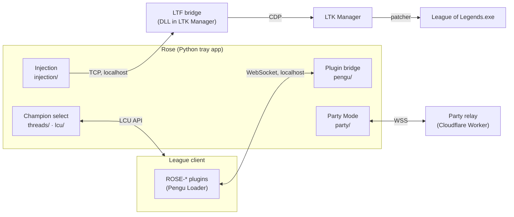

# Contributing to Rose

Thanks for helping out. Bug reports, translations and pull requests are all welcome, and [Discord](https://discord.com/invite/roseskins) is the place for questions. The second half of this page, [Architecture](#architecture), explains how the pieces fit together.

## Reporting bugs

Use the [**Bug report**](https://github.com/Alban1911/Rose/issues/new/choose) form. It asks for your Rose version, League patch, region and game mode, the message in Rose's **Troubleshooting** panel, and the latest log from **Open Logs Folder**. Remove party tokens, account names and personal paths before posting. Ideas go in the **Feature request** form.

## Development setup

You need Windows 10 or 11, Python 3.11 or newer (CI uses 3.12), and [LTK Manager](https://github.com/LeagueToolkit/ltk-manager/releases) installed.

```powershell
git clone https://github.com/Alban1911/Rose.git
cd Rose
python -m venv .venv
.venv\Scripts\Activate.ps1
python -m pip install -r requirements.txt
```

Rose needs two native pieces before it can run from source. Building them needs [Visual Studio Build Tools](#build-tools).

```powershell
python scripts/build_pengu_loader.py   # Pengu Loader.exe, from vendor/PenguLoader-1.1.6/
python scripts/build_ltf.py            # ltk_launcher.exe + LeagueToolFlop.dll, into injection/tools/
```

Then run Rose from an **elevated** terminal:

```powershell
python main.py --dev --verbose
```

`--dev` skips the launcher (update check, skin sync, mod migration) and writes no log files unless you add `--logs`. `--debug` logs even more.

**Party Mode** needs a relay URL. Either set `ROSE_RELAY_URL`, or create the gitignored `party/network/relay_config.py`:

```python
RELAY_URL = "wss://<relay-host>"
```

To work on the relay itself, run it locally and point Rose at it with `ROSE_RELAY_URL=ws://127.0.0.1:8787` (see [Party relay](#party-relay)).

## Building

`scripts/build_pyinstaller.py` is the build entry point: it builds Pengu Loader and the LTF bridge, then packages Rose with PyInstaller. Don't run `pyinstaller Rose.spec` directly. The build refuses to start without `party/network/relay_config.py`, so Party Mode never ships without a relay.

| Command | Output |
| --- | --- |
| `python scripts/build_pyinstaller.py` | `dist/Rose/` (add `--skip-pengu-loader` to reuse the current loader build) |
| `python scripts/build_all.py` | The above, plus `installer/Rose_Setup_<version>.exe` |
| `python scripts/create_update_package.py` | `installer/update_package_<version>.zip`, the package the auto-updater downloads |

### Build tools

- **Visual Studio Build Tools** with:
  - .NET desktop build tools, WPF, and the .NET Framework 4.7.2 targeting pack (Pengu Loader)
  - MSVC C++ build tools with C++20 (the LTF bridge, from `native/ltf/`)
- **Inno Setup 6**, only for the installer

## Tests and checks

CI runs all of these on every pull request and every push to `main`. Run the ones for what you touched before opening a pull request.

```powershell
# Python unit tests: test/ and every package's tests/ folder (Windows only)
$suites = @('test') + (Get-ChildItem -Directory | ForEach-Object { Join-Path $_.Name 'tests' } | Where-Object { Test-Path $_ })
foreach ($suite in $suites) { python -m unittest discover -s $suite -t . }

# Python lint: syntax errors and undefined names only
python -m pip install ruff
python -m ruff check . --select E9,F63,F7,F82

# Plugins: syntax check, then the JS regression tests (Node.js 22+)
git ls-files 'Pengu Loader/plugins/*.js' | ForEach-Object { node --check $_ }
node --test "test/*.test.cjs"

# Party relay
cd relay-worker; npm ci; npm run typecheck; npm test; cd ..
```

- Python tests need Windows: several modules call `ctypes.windll` when imported.
- A plugin with a syntax error doesn't fail loudly; it just never loads in the client. Always run `node --check`.
- Put Python tests in the `tests/` folder (with an `__init__.py`) of the package they cover. CI picks up a new package's `tests/` folder by itself.
- `scripts/test_startup_diagnostics.ps1` and `scripts/test_update_prompt.ps1` are manual checks for the diagnostics collector and the update prompt.

CI also lints the workflows in `.github/` (actionlint, zizmor) and reviews dependency changes.

## Pull requests

- Branch off `main`: `fix/chroma-crash`, `feat/skin-preview`, `docs/readme`.
- Write commits as `type(scope): summary`, like the history: `fix(party): ...`, `feat(mods): ...`.
- Keep one change per pull request, and make sure CI passes.
- Skin package bugs (a broken model, missing sounds) belong in [LeagueSkins](https://github.com/Alban1911/LeagueSkins), not here.

## Writing plugins

Plugins live in `Pengu Loader/plugins/ROSE-<Name>/index.js`. `ROSE-SkinMonitor` hosts the WebSocket connection to Rose and exposes it as `window.__roseBridge` once it knows the port. Wait for that object to appear, then use:

| Method | Use |
| --- | --- |
| `send(payload)` | Send a message to Rose |
| `subscribe(type, cb)` / `unsubscribe(type, cb)` | Receive Rose's messages of a type |
| `onReady(cb)` | Run once the bridge is connected |
| `onDisconnect(cb)` | Run when an open connection to Rose closes (not on each failed reconnect), so a plugin waiting for an answer can give up |

Messages from the plugins are routed in `pengu/communication/message_handler.py`.

## Translations

Rose's menus are translated in `Pengu Loader/plugins/ROSE-I18n/locales/`, one `<language>.json` per language, keyed by the English text. A missing text falls back to English. Both the plugins and the Python side (`utils/core/i18n.py`) read these files. To add a language, copy an existing file and translate the values.

## Party relay

The relay is a Cloudflare Worker in `relay-worker/` (TypeScript). The tests build the Worker and exercise WebSocket upgrades against a local Durable Object with SQLite storage.

```powershell
cd relay-worker
npm ci
npm run dev    # local relay on ws://127.0.0.1:8787
```

Relay deployments outside loopback use WSS. Protocol changes must ship together with a matching Rose release: the relay answers HTTP 426 to clients it no longer supports, and clients wait for the relay's protocol acknowledgement before exchanging party state. Existing invite tokens keep their room keys.

---

# Architecture

How Rose is put together.

## Overview



Rose has four parts:

| Part | Where | Role |
| --- | --- | --- |
| Python backend | repository root | The tray app: follows champion select, decides what to inject, drives LTK Manager |
| Client plugins | `Pengu Loader/plugins/` | Rose's menus inside the League client |
| LTF bridge | `native/ltf/` | Lets Rose drive LTK Manager, which patches the game |
| Party relay | `relay-worker/` | Shares skin picks between friends |

## Python backend

`main.py` starts the **launcher** (`launcher/`), which runs before the app proper:

1. **Update check**: looks for a newer GitHub release, downloads its update package, and hands it to a Windows helper that stages it beside the installation (`<install>.update`) before switching.
2. **Game hashes**: refreshes `hashes.game.txt` from CommunityDragon.
3. **Skin sync**: syncs the skin library from the [LeagueSkins](https://github.com/Alban1911/LeagueSkins) manifest, downloading only the files that differ.
4. **Mod migration**: moves mods an older Rose stored itself into LTK Manager's library, once.

The app (`main/`) then requires administrator rights, takes a single-instance lock, starts the tray icon, activates Pengu Loader, and starts its threads. It talks to:

- **the League client** through the LCU API: REST calls, and the client's WebSocket for events. Credentials come from the client's lockfile, or from `LeagueClientUx.exe`'s command line when a regional client leaves it empty (`lcu/core/lockfile.py`). Rose waits for the lockfile with a folder change notification instead of a timer.
- **the plugins** through a WebSocket server on localhost (`pengu/core/websocket_server.py`), plus an HTTP handler for skin previews and assets. Only loopback origins are accepted (`utils/core/security.py`).
- **LTK Manager** through the LTF bridge (below).
- **the party relay**, when Party Mode is on.

Rose's data lives in `%LOCALAPPDATA%\Rose` (`utils/core/paths.py`): the skin library (`skins/`), state, logs, and per-champion history.

## Client plugins

Rose activates [Pengu Loader](https://github.com/PenguLoader/PenguLoader) at startup, which loads `core.dll` into the League client and runs the plugins. If the client is already open, Rose restarts it so the plugins load (during champion select, it waits for the lobby or the end of the game). `utils/integration/startup_verifier.py` checks, read-only, that they did.

Pengu Loader is vendored in `vendor/PenguLoader-1.1.6/` and built with Rose.

| Plugin | Role |
| --- | --- |
| `ROSE-SkinMonitor` | Reports the hovered skin to Rose, and hosts the bridge the other plugins use (`window.__roseBridge`) |
| `ROSE-UI` | Unlocks locked skins in champion select so they can be hovered |
| `ROSE-ChromaWheel` | Chroma picker for any skin |
| `ROSE-FormsWheel` | Form picker (Elementalist Lux, Sahn-Uzal Mordekaiser, Spirit Blossom Morgana, Radiant Sett) |
| `ROSE-CustomSkinSelector` | Lists the custom skin mods made for the hovered skin |
| `ROSE-CustomWheel` | Custom maps, fonts, announcers and other mods |
| `ROSE-RandomSkin` | Random skin pick |
| `ROSE-HistoricMode` | The last skin used on each champion |
| `ROSE-PartyMode` | Party Mode panel in the lobby and champion select |
| `ROSE-SettingsPanel` | Rose's settings and Troubleshooting panel |
| `ROSE-I18n` | Translations, in `locales/<language>.json` |
| `ROSE-Jade` | Client customization (borders, banners, icons, titles). Shipped disabled (`index.js_`) |

The Python `ui/` package is headless: it keeps chroma, random and historic state for these plugins.

## Injection

Rose doesn't patch the game itself. It hands skins to **LTK Manager**, whose patcher overlays them on the game's files.

**The LTF bridge** (`native/ltf/`, built into `injection/tools/`) connects the two. `ltk_launcher.exe` starts LTK Manager hidden and injects `LeagueToolFlop.dll` into it. The DLL serves a newline-delimited JSON API on `127.0.0.1` (ports 46321 to 46340), authenticated with a token it publishes for the current user, and drives LTK Manager's backend over CDP: import, switch on or off, and uninstall mods, start and stop the patcher. `injection/tools/bridge.py` is the client.

Rose only drives an LTK Manager it started, and closes it after the game. A running one is left alone. LTK Manager is found through `ltkManagerPath` in `config.ini`, then a running instance, then the known install locations (`injection/tools/tools_manager.py`). [`native/ltf/VENDORED.md`](native/ltf/VENDORED.md) lists Rose's changes to the LTF sources, and [`docs/ltf-vrf-host-verification.md`](docs/ltf-vrf-host-verification.md) explains why LTK Manager must be started with `explorer.exe` as its recorded parent.

**Playing a skin as the base skin.** Rose selects the champion's base skin (skin 0) in the client and plays the chosen skin under its identity, since the game and the patcher refuse a base skin that is another skin's data. `injection/baseskin/` rewrites a skin package to match: merged sound banks, renamed bank units, model and skeleton under the base skin's paths, and the base skin's name. It is a port of RoseBin's rebase, which applies the same steps to the skins Rose ships.

## A game, step by step

1. **Champion select.** `threads/` follows the gameflow phase and the client's events. `ROSE-SkinMonitor` reports the hovered skin name, and `pengu/processing/` maps it to a skin ID. Chroma, form, custom mod and party selections arrive through the same bridge.
2. **Owned skins are skipped.** If the client lets you select the skin, Rose doesn't inject anything for it.
3. **Injection threshold.** `threads/handlers/injection_trigger.py` follows the loadout countdown. At the threshold (1 to 2 seconds before the end, set in Settings), it forces the base skin through the LCU and locks in the skin. Later changes are ignored.
4. **Staging.** `injection/core/` builds a stage plan: the skin, its loading screen name mod (`injection/loadingname/`), the selected custom mods, and friends' skins in Party Mode. `injection/overlay/` imports them into LTK Manager through the bridge, switches off your own mods, and starts the patcher.
5. **Game start.** The patcher only overlays a game created after its scan started. If the client starts the game earlier, Rose suspends it, then kills it and has the client reconnect to the match (`injection/game/reconnect.py`).
6. **After the game.** Rose stops the patcher, removes what it imported (saved custom mods stay in LTK Manager, switched off, so the next game doesn't import them again), switches your own mods back on, and closes LTK Manager if it started it. `injection/overlay/ltf_journal.py` records what a session changed in LTK Manager, so a session cut short is cleaned up at the next start. A game left suspended by a Rose that closed is resumed when Rose starts again.

## Party Mode

Friends share a room on the party relay (`relay-worker/`), a Cloudflare Worker with one Durable Object per room and up to 10 members. Each member broadcasts their skin selection, and Rose injects friends' skins alongside yours. Custom mods are matched by content hash (`party/discovery/custom_mods.py`): mod files never leave the PC, and a friend's mod is only used when you have your own copy.

- **Protocol.** The relay refuses Rose versions older than 1.4.4 with HTTP 426, and clients require a protocol v2 acknowledgement before exchanging party state.
- **Identity.** An invite token carries the room key, which grants access to join. Each installation also joins with a credential derived from its private `party_identity_keys.json`: while a member is connected, only the same installation can take over that summoner ID. The relay stores no bindings, so once a member leaves, any installation can use their ID again (a reinstall or another PC is never locked out).
- **Blocked networks.** Some networks block only some of the relay's addresses (Spanish ISPs drop Cloudflare IP ranges during LaLiga matches). Rose tries the address that worked last, then the system resolver's, then DNS-over-HTTPS answers, keeping the hostname for TLS (`party/network/relay_addresses.py`).
- **Relay URL.** Read from the gitignored `party/network/relay_config.py`, or the `ROSE_RELAY_URL` environment variable.

The STUN and UDP modules in `party/network/` are left from an earlier peer-to-peer design and are no longer used.

## Code map

| Path | Content |
| --- | --- |
| `main.py`, `main/` | Entry point, startup, single-instance lock, main loop, shutdown |
| `config.py` | Constants and defaults |
| `launcher/` | Startup sequences (update, hashes, skin sync, mod migration) and the auto-updater |
| `lcu/` | League Client API: lockfile, connection, skin scraping, game mode, Swiftplay |
| `threads/` | Phase, champion, lobby and countdown threads, and the injection trigger |
| `pengu/` | WebSocket and HTTP server for the plugins, message routing, skin name mapping |
| `injection/core/` | Injection manager, injector, stage plan |
| `injection/overlay/` | The LTF session: LTK Manager's library, switches, patcher, journal, error reports |
| `injection/mods/` | Custom mod storage, manifests, `.fantome` packing, migration, LTK library sync |
| `injection/baseskin/` | Rewrites a skin to run as the base skin (WAD, BIN and BNK editing) |
| `injection/game/` | Game detection, hold and resume, reconnect |
| `injection/loadingname/` | The skin's name on the loading screen |
| `injection/tools/` | Bridge client, and where the built LTF binaries go |
| `party/` | Party Mode: relay client, tokens, lobby matching, skin collection |
| `ui/` | Headless chroma, random and historic state for the plugins |
| `state/` | Shared state and the tray status |
| `utils/` | Logging, paths, downloads, tray, Pengu Loader integration, diagnostics, Win32 helpers |
| `analytics/` | Installation ID and analytics pings |
| `Pengu Loader/` | Loader runtime files and the `ROSE-*` plugins |
| `relay-worker/` | Party relay (TypeScript, Cloudflare Workers) |
| `native/ltf/` | Vendored LTF sources for the bridge |
| `vendor/PenguLoader-1.1.6/` | Vendored Pengu Loader source |
| `assets/` | Icons, fonts, form button art, the diagnostics collector |
| `scripts/` | Build scripts and manual PowerShell checks |
| `installer.iss`, `Rose.spec` | Inno Setup installer and PyInstaller spec |
| `test/`, `*/tests/` | Cross-package and JS tests, and each package's unit tests |
